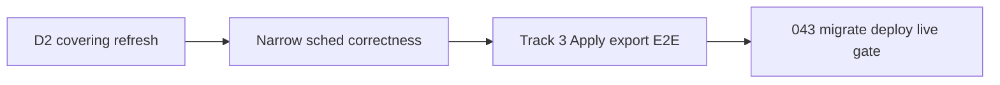

# First usable scheduler — critical-path estimate (2026-10-21, rev 4)

**Status:** **Planning only — Jim/Page for Dex.** **No** coding unlock · **no** push · **no** deploy / household / live / Apply authorization. All standing holds remain.

**Forecast lineage:** Dex Slack **`1792643097.665299`** — **`793dd40`** **NOT ACCEPTED** (invented waits, uncalibrated midpoint, Track 3 greenfield bias). Estimate rev 2 @ **`a8b7f3c`** — **§10 NOT ACCEPTED** (unsupported calendar waits, Path A priced with **forbidden** import-only/subset-readiness shortcuts). Rev 3 @ **`c7290f3`** — Dex Slack **`1792643413`** + **`1792643436`**: **NOT ACCEPTED** as Cabinet timeline when read as **~33–83 conventional serial ED** (§5.4) — that band is **uncalibrated builder accounting**, not verified elapsed forecast. **This revision (rev 4)** supersedes **`c7290f3`** for planning; **primary forecast unit = Cabinet / agentic cycles** (§5). D2 contract **rev 2** engineering body @ commit **`c7290f3`** — [`0.7-S2-D2-Covering-Refresh-Contract-2026-10-21.md`](0.7-S2-D2-Covering-Refresh-Contract-2026-10-21.md) (**estimate independent** of contract text; prior land **`bbca16c` NOT ACCEPTED** @ Slack **`1792643285`**). Whole-path compare **`1792643054`** — **two SAFE sequences only** in §10 (carried from **`c7290f3`**).

**Cadence assumption (Trish `1792643383`):** **Current Cabinet cadence** + **agent-assisted development as practiced today** — Jim-orchestrated slices, finite specialist lanes (§5.1), Dex integrated review bounces comparable to recent T2 tips (§5.2). **Overnight / Trish–Julie / provider auth** waits are **real** but **unscheduled** (§5.5) — **no** invented multi-day Cabinet delays and **no** verified “calendar weeks save ED” tradeoffs.

**Pairs with:** Decision **3** local-close @ [`0.7-S2-D3-Safe-Usable-Gap-2026-10-21.md`](0.7-S2-D3-Safe-Usable-Gap-2026-10-21.md) (**`3b84332`**) · criteria canon @ [`0.7-S2-T2-D3-Criteria-Reconcile-2026-10-21.md`](0.7-S2-T2-D3-Criteria-Reconcile-2026-10-21.md). **Cabinet authority (available):** [`F:/Code Repo/Cabinet/outputs/scheduler-investigation/Implementation-Plan-2026-10-19.md`](../../../Cabinet/outputs/scheduler-investigation/Implementation-Plan-2026-10-19.md) §IX Decision **2** — **not** blocked on tree absence.

**Grounding pins:** D3 **CLOSED LOCALLY WITH QUALIFICATIONS** (Dex **`1792642572`**, Julie **`1792642595`**, Trish) · REC-UI @ API **`2b290eb`** / web **`da5a535`** · F6 lock-order **OPEN** @ **`8c83c03`** · clock-slide-without-sync **OPEN** · household Alembic **`042`** live / **`043`** disposable only · **C2 `EXCEEDS_SLICE`** fail-closed only.

**Out of scope for this estimate:** S2-V6/V7 expansion, DEF-040/OPT-CONVERT, `C-HELD-MISS-AUTO`, T2-S4 migrate, full Impl Plan §VII.1 lifecycle/split/skippable backlog, V6 buffer remainder, context/event-travel, unrelated NEXT-FEATURES slices (F1–F7 productization).

---

## 1. Definition — “first usable scheduler” (this packet)

**Not** Closed/shipped · **not** full safe-everyday milestone · **not** D3 reopen.

**First usable** means Trish can run the **authorized household production stack** (post-**043** migrate, rebuilt api/web/scheduler, **live** Google/Graph paths explicitly cleared) through a **repeatable daily loop**:

1. **Covering refresh** chosen calendar subscriptions for an explicit window and read **honest freshness + busy-input trust** (Decision 2 — D2 contract rev 2 at linked tip SHA; **`bbca16c` NOT ACCEPTED**).
2. **Calculate → Preview → Apply** schedule proposals with existing **fail-closed** gates (freshness, trust, revision/stale rules) and **export** mirrored blocks to provider calendars (Track 3 obligations).
3. **Held-miss disposition** via landed UI (leave / skip / release / reviewed recover) — already **local** WITH QUALS; live spot-check only in acceptance, not re-build.
4. **Single-block occurrence bounds** (T2-S1) and core placer path already on household S2 train — no claim that split-bounds or full Track 2 §VII.1 semantics ship here.

**Explicit baseline limitation (Trish may accept):** **C2** remains **fail-closed** (`BLOCKS_PREVENT_NEXT_NORMAL`); historical-block isolation **`EXCEEDS_SLICE`** — recovery blocked when same-task blocks poison next-normal; **no** delete/unpin workaround.

**Separate gate (phase 4):** migrate / deploy / live validation is **operator-approved window** — **unscheduled** external time; **not** folded into eng-day (ED) totals.

---

## 2. Critical path — four bounded pieces + release gate

Dex framing (integrated review, not one UI fix):

| Phase | Intent | Depends on |
| --- | --- | --- |
| **1 — D2** | Covering refresh + trust/readiness reporting | Dex D2 **contract rev 2** (boundaries 1–5, **V1–V30**); disposable API proof; minimal web to **see** readiness |
| **2 — Narrow scheduling correctness** | Only what blocks trustworthy Preview/Apply on real data | Partial overlap with Track 1 residuals; **named deferrals** §3.2 with **validation obligations** §3.4 |
| **3 — Safe Apply/export + E2E** | Track 3 + Preview/replan/Apply milestone slice; disposable then staging evidence | Phase 1 freshness/trust; Phase 2 Apply-safe stale coordination |
| **4 — Household / live window** | Alembic **043**, rebuild, Trish live-path auth, scoped real-data validation | Phases 1–3 accepted locally; Julie preserve |

**Parallelism:** Phase 2 **F6 lock-order trace + V20-class tests** can run beside D2 API if Dex accepts “no production lock rewrite in D2 wave.” Phase 3 **contract freeze / gap inventory** can start during late D2. **No** parallel household migrate before Phase 3 local accept.

---

## 3. Must-have vs deferrable

### 3.1 Must-have (first usable baseline)

| Item | Why |
| --- | --- |
| **D2** contract rev 2 + `covering-refresh` API + structured readiness payload | Without forced covering, Google incremental omit (T1-12 qual) leaves untrustworthy busy for collect/Apply |
| **Minimal web** — “refresh visible range” + freshness/trust readout (settings or calendar surface) | API-only is testable but not **operator-usable**; web currently ignores sync window ([D2 contract §2](0.7-S2-D2-Covering-Refresh-Contract-2026-10-21.md)) |
| **Preview / replan / Apply** path on stack with **trust + freshness + revision** gates exercised end-to-end | Safe-usable milestone requirement ([criteria §1.3](0.7-S2-T2-D3-Criteria-Reconcile-2026-10-21.md)); ≠ recovery path |
| **Track 3 safe Apply/export** — verify existing DB/mirror safeguards + close **documented** deletion-lifecycle gaps or fail-closed | Track 3 called out on every T2 tip; T1-11 baseline hooks landed; **not** a greenfield Apply stack (§3.3). **Cycle budget uncertain until Track 3 contract freeze** — **update this estimate at next Track 3 slice** (§5.3) |
| **Apply-safe stale/fingerprint slice** — smallest **S2-V5-class** audit so calendar/settings bumps invalidate Preview honestly before Apply | CUTOVER: full V5 activation audit deferrable; **Apply-path** categories are not |
| **Prefer afternoon + DEF-045** household re-verify | If daily workflow uses custom `afternoon` Prefer ([CUTOVER current](0.7-S2-CUTOVER.md)); code largely green @ **`6b3f581`** — mostly verification + residual fix |
| **F6 lock-order** — **observed-order trace + targeted tests (incl. V20)** **or** qualified non-blocker with **evidence** | Pre-existing @ **`8c83c03`**; D2 qual: no production lock rewrite in D2 wave |
| **Household 043** + migrate/rebuild + **Trish live-path authorization** | Live **`042`** vs recovery **`043`**; gap packet §2 |
| **D3 chain** (held + REC-UI) | **Already CLOSED LOCALLY WITH QUALS** — acceptance re-check on live data only |

### 3.2 Deferrable (not launch blockers for this baseline)

| Item | Notes |
| --- | --- |
| **C2 historical-block isolation** | Stay **fail-closed**; Trish accepts blocked recover when blocks poison next-normal |
| **Clock-slide automatic** preview invalidation / banner | **Defer UX only** if §3.4 clock-slide **validation** passes — not “manual refresh” alone |
| **F6 production lock reorder** | Defer **reorder** if observed-order trace + V20 + D2 cross-account trace **accepted** — not doc-only |
| **T2-S3** split / multi-piece bounds | T2-S1 single-block stands |
| **Lifecycle** complete/trash-as-disposition | WAIT product — **not** invented as accepted deferral |
| **Skippable-at-author**, **post-skip reactivation** | Outside D3 local-close; not daily-loop blockers |
| **T2-S4** 11 stand-in migrate | Consequential; isolated dry ≠ production |
| **Flexible exceptions** widen/remove bounds (Impl Plan §VII.1) | Missing impl; defer |
| **T1-12** operator full-refresh **cadence** / backfill tool | D2 is **on-demand** covering; cadence policy separate |
| **Full S2-V5** gate across all V1…V4b activations | Take **Apply-path** subset only |
| **S2-V6** SS-30 remainder, **S2-V7** context/event travel | Explicitly out of this estimate |
| **DEF-040** remainder / OPT-CONVERT | Post-0.7 visibility |
| **`C-HELD-MISS-AUTO`** | Productization / POLISH-DEFERRED |

### 3.3 Implementation inventory — existing vs missing (large lines)

**Method:** repo + disposable tip evidence as of D2 contract rev 2 baseline; **missing** = not implemented or not verified for first-usable claims. Budget **verification + gap closure**, not full rewrite where row says **exists**.

| Line | Exists (code / disposable evidence) | Missing / unverified for first usable | ED implication |
| --- | --- | --- | --- |
| **`POST …/covering-refresh`** | **Missing** — no route; contract rev 2 only | Full Phase 1 API + **V1–V30** (incl. revision barrier + lock-order rows) | **Greenfield** (largest Phase 1 band) |
| **Import-only / no remote DELETE on D2** | Legacy `sync_account_events` **violates** (tombstone retry) — documented in [D2 contract §3–§4](0.7-S2-D2-Covering-Refresh-Contract-2026-10-21.md) | Dedicated seam + spies | Part of D2 greenfield |
| **Per-sub durable commits (partial refresh)** | Legacy single outer commit — **observed**, not covering | New orchestration per contract §4 | Part of D2 greenfield |
| **Dual readiness (subset action vs all-enabled horizon)** | `evaluate_calendar_freshness` + `evaluate_busy_input_trust` **exist**; not wired to covering response | Response assembly + **V13–V15** | Moderate within D2 |
| **Minimal web covering UX** | Calendar preview/replan polling **exists**; **no** covering refresh control or viewport→window | New UI slice post API ACCEPT | Separate band after D2 API |
| **`apply_schedule_preview` gates** | **Exists** — trust, freshness, revision/fingerprint stale, temporal stale, past blocks, idempotent receipt (`schedule_preview_apply.py`) | Live-path + export failure matrix; deletion-lifecycle at export edge | **Verify + extend**, not 5–10 ED greenfield |
| **F6 W2 preview/Apply test corpus** | **Exists** — large disposable suite (`test_f6_w2_preview_apply.py`, ~1.7k lines) | Map to Track 3 contract rows; close any red gaps Dex names | **Evidence pass** dominant |
| **Preview staleness / V5-class** | **Exists** — `preview_stale_categories`, Boundary B bumps, T1 stale tip @ **`f75cc39`** | Audit **Apply-path** activations only (calendar/settings/task edits per CUTOVER) | **2–6 ED** if bounded; not full V5 |
| **T1-11 export baseline hooks** | **Exists** @ **`dc0701d`** (66-pass selected); deletion **policy unchanged** | Track 3 **lifecycle** semantics still qual per T1-11 tip | **Gap closure or fail-closed export**, not re-implement hooks |
| **Calendar mirror push on Apply** | **Exists** in `apply.py` | Provider failure / partial export / race with refresh | Targeted tests + operator-visible errors |
| **Held skip / release / recover** | **Exists** locally (T2-S2-RS, REC, REC-UI tips) | Live **write** path in scoped auth (§7) | Spot-check + cleanup rules, not re-build |

### 3.4 Deferral safety arguments (required validation — not “qualification” by wording)

| Deferred item | Minimum safety argument before defer stands | If validation fails |
| --- | --- | --- |
| **F6 production lock reorder** | Written lock trace matches D2 cross-account design; **V20** + F6 writer tests green on disposable; Dex accepts trace vs **`8c83c03`** | Must implement bounded reorder or block D2 multi-account ship |
| **Clock-slide auto UX** | **Prove** Apply and/or Preview **fail-closed** when wall advances without sync (trust/freshness/stale categories) — extend disposable tests; manual D2 refresh is **mitigation**, not proof | Promote auto invalidation banner or block first-usable sign-off |
| **Track 3 deletion lifecycle gaps** | Export/retire path **fail-closed** when tombstone/baseline state ambiguous; no silent orphan mirror writes — disposable negative tests | Small impl slice **or** explicit operator procedure with **fail-closed** API (not doc-only) |

---

## 4. Dependencies

| Dependency | Blocks |
| --- | --- |
| Dex integrated review **D2 contract rev 2** (boundaries 1–5 + validation **V1–V30**) | Phase 1 **API-only** coding unlock |
| D2 API ACCEPT (disposable, mocked providers) | Phase 3 E2E that assumes covering semantics; minimal web start |
| Narrow **Track 3 / Apply** contract freeze (inherit F6 W2 + Boundary B where accepted) | Phase 3 **gap-closure** start (evidence may start earlier read-only) |
| Phase 3 **local** ACCEPT WITH QUALS | Phase 4 migrate authorization conversation |
| Trish **live-path** + Julie **preserve** + **043** plan | Phase 4 execution |
| **DEF-045** disposition if re-verify fails | Prefer-path on household (may add small fix loop inside Phase 2) |
| Cabinet §IX D2 wording | Final contract lock — source @ **`F:/Code Repo/Cabinet/.../Implementation-Plan-2026-10-19.md`** |

**Non-dependencies (do not serialise ahead of D2):** F6 full green suite; clock-slide **UX** spec; C2 isolation project; D3 reopen.

---

## 5. Remaining work — Cabinet / agentic cycles (primary forecast)

### 5.0 What we measure (primary vs secondary)

| Unit | Definition | Role in this rev |
| --- | --- | --- |
| **Cabinet cycle** | One bounded tranche: **named unlock or contract land** → implementation (Justin/Tesla/Andi) → Quality (Renee) → Page tip → **Dex integrated review** → ACCEPT or bounce. Contract-only cycles (Page + Dex, no coding unlock) count separately. | **Primary** remaining-work forecast (§5.3, §10) |
| **Active session hours** | **Aggregate** specialist time inside Jim-attended Cabinet sessions (builders + Renee + Page; not “one human × 6h/day”). Parallel lanes **sum**; they do **not** map 1:1 to wall clock. | **Secondary numeric hint** where tip timestamps support scaling — **wide uncertainty** |
| **Serial critical path** | Minimum **cycle order** when gates in §2 / §10 are respected (SAFE B default). | D2 contract → D2 API ACCEPT → V5-class → minimal web → Track 3 E2E → **043**/live |
| **Concurrent lanes** | Limited overlap (§5.1, SAFE A) — **does not** remove shared Dex review cycles. | F6 trace + V20/V25 scaffolding beside early D2 API only |
| **Overnight / operator / provider waits** | Trish disposition, Julie preserve, household window, OAuth/provider flake. | **Excluded** from cycle totals — §5.5 |
| **Conventional serial ED** | Single-engineer **6h** “eng-day” sum (§5.4). | **Secondary, uncalibrated** — Dex **`1792643413`** + **`1792643436`**: **do not** quote **~33–83 ED** as Cabinet elapsed |

### 5.1 Available team (not unlimited parallel agents)

**Orchestration:** Jim (operator + unlock authority) with **A-team specialists as used on 2026-10-21 T2 chain** — not unbounded concurrent agents.

| Lane | Typical ownership | Parallelism notes |
| --- | --- | --- |
| **Justin** | API/domain, cross-cutting scheduling correctness, hard refactors | One primary API builder lane per slice |
| **Tesla** | Sync/import seams, SQLite/Postgres edges, lock-order traces with D2 | Can run **beside** Justin **after** trace frozen (SAFE A) |
| **Andi** | Web UX, mechanical refactors, localized UI | Starts **after** D2 API ACCEPT for covering UX |
| **Renee** | Disposable pytest, browser matrix, security-sensitive validation | **Serial** before each Dex impl return — not optional |
| **Page** | Contract/tip/docs stamps | **Serial** Dex review packets |
| **Steve** | Multi-phase orchestration on large slices | As needed — not extra builder capacity |

**Implication:** Aggregate session hours can exceed wall clock within a single evening (REC-UI), but **Dex review** and **Jim attention** still **serialize** phase exits on SAFE B.

### 5.2 Calibration anchors — recent slices (elapsed + bounces)

Slack timestamps → **America/Los_Angeles** (operator TZ). Elapsed = **wall clock between cited Slack events only** — **not** total human-hours (agents parallel inside sessions). Tip docs record bounces; they **do not** record ED.

| Slice | Dex outcome | Review bounces | Evidence scale | Elapsed (tip Slack anchors) | Scale vs D2 |
| --- | --- | --- | --- | --- | --- |
| **T2-S2-RS** | ACCEPT WITH QUALS **`1792616288`** | **1** impl | 43 API tests | Unlock **`1792615094`** → accept **`1792616288`**: **~0.3 h** same-day | **Smaller** than D2 API |
| **T2-REC** | ACCEPT WITH QUALS **`1792634057`** | **2** impl | 82 tests + mig **`043`** disposable | Contract unlock **`1792629456`** → accept **`1792634057`**: **~1.3 h** same-day | **D2 API comparable class** (service greenfield) |
| **T2-REC-UI** | ACCEPT LOCALLY **`1792642492`** | **3** impl + **1** contract | API + web + browser matrix | Coding unlock **`1792635005`** → accept **`1792642492`**: **~2.1 h** same-day | **Minimal web** band — **not** full D2 orchestration |
| **T1 stale Preview** | ACCEPT @ **`f75cc39`** | **1** (tip) | Boundary B + rollback | *No Slack elapsed row in delivery docs* | **Phase 2 V5** partial analog |
| **T1-11 baseline** | ACCEPT @ **`dc0701d`** | **1** (tip) | 66 selected; hooks only | *No Slack elapsed row* | **Phase 3** partial analog; lifecycle **open** |

**Calibration limits:** No landed slice matches D2 (**V1–V30** + greenfield `covering-refresh` + cross-account commits). D2 Phase 1 is **partially calibrated** — **more cycles and more aggregate session time than T2-REC**, and **likely more impl bounces than RS**. **Phase 3 Track 3** remains **weakly calibrated** until a **Track 3 contract / gap inventory** slice lands — **update §5.3 then**.

### 5.3 Bounded Cabinet cycles — remaining path (serial critical path default)

**One cycle** ≈ one impl return (or one contract revision) through Dex review. Ranges are **planning bounds**, not promises. **Low** = fast ACCEPT, bounded scope, fail-closed gaps without re-architecture. **High** = D2 **`1792643285`-class** contract churn, Track 3 deletion-lifecycle impl, DEF-045 fix wave, extra Dex bounces.

| Phase | Serial cycles (bounded) | Aggregate active session hours (hint) | Calibration |
| --- | --- | --- | --- |
| **0 — D2 contract rev 2 ACCEPT** | **1–2** | **~3–8 h** (Page/Justin/Tesla + Dex) | **`bbca16c` NOT ACCEPTED** @ **`1792643285`** — one bounce already |
| **1a — D2 API** (+ disposable **V1–V30**) | **3–6** | **~12–28 h** | Partial — **> T2-REC** (~1.3 h wall was **2** bounces, smaller surface) |
| **1b — Minimal covering web** | **1–2** | **~4–12 h** | Weak — REC-UI-scale **without** full matrix if scope stays minimal |
| **2 — Narrow sched correctness** (V5-class, DEF-045, F6 trace/tests, clock-slide proof) | **1–3** | **~4–16 h** | Partial — can **overlap 1 cycle** with late **1a** if Dex accepts (SAFE A) |
| **3 — Track 3 verify + E2E** | **2–5** | **~8–28 h** | **Uncertain — revise at next Track 3 slice** (contract freeze / gap list) |
| **4 — 043 + scoped live validation** | **1** (+ operator window) | **~3–9 h** active | Weak — provider/auth |
| **Phase-exit Dex reviews** (integrated, whole-path) | **+2–4** | *(overlaps session hours above)* | Qualitative — same cadence as T2 tips; **not** converted to days |

**Totals (first usable, incl. minimal web, SAFE B serial exits):**

| Metric | Low | High | Notes |
| --- | --- | --- | --- |
| **Impl + contract cycles** (phases 0–4, excl. §5.5 waits) | **~9** | **~19** | |
| **+ Rework / redo cycles** (§10) | **+1** | **+3** | Lock trace drift, Track 3 churn, live flake |
| **Aggregate active session hours** (specialists summed) | **~35 h** | **~90 h** | **Not** Cabinet elapsed; **not** ED |
| **Jim-attended serial evenings (very rough)** | **~4** | **~10** | **Uncertain** — assumes ~2–4 h useful forward progress per focused session after **`1792643383`** cadence; **not** verified |

**Track 3 explicit uncertainty:** F6 W2 corpus **exists**, but **deletion-lifecycle closure size** and **contract row count** are **not frozen**. Treat Phase 3 cycle band as **placeholder** until the next Track 3 planning slice — then **re-stamp this doc (rev 4.x or rev 5)** with narrowed cycles.

**Arithmetic note:** §10 **rework cycles** are **additive** on top of phase bands, not double-counted inside them.

### 5.4 Secondary — conventional serial ED (uncalibrated; not Cabinet forecast)

**Dex `1792643413` + `1792643436`:** rev 3’s **~33–83 active ED** table is **retained for builder accounting only** — **must not** be read as “first usable lands in 33–83 days” or as verified wall-clock savings.

| Phase | Active ED (serial) — secondary |
| --- | --- |
| **1 — D2** (API + minimal web) | **16–34** |
| **2 — Narrow correctness** | **4–14** |
| **3 — Track 3 + E2E** | **9–26** *(uncertain)* |
| **4 — Live gate** | **3.5–9** |
| **Sum** | **~33–83** *(uncalibrated — no midpoint)* |

ED bands unchanged from **`c7290f3`** derivation; see phase breakdown in git history if needed. **Parallel agents inflate ED sum vs calendar**; **Dex review serializes** phase exits.

### 5.5 External gates (unscheduled — no fabricated duration)

| Gate | Owner | Effect on cycles |
| --- | --- | --- |
| Dex D2 **contract rev 2 ACCEPT** | Dex | Blocks Phase **1a** coding unlock |
| Post-impl Dex **integrated review** (D2 API, Track 3, whole-path) | Dex | **+cycles** between phases; **duration not estimated** |
| Trish / Julie **043 + preserve + live-path** | Trish, Julie | Blocks Phase **4** execution — **operator window unscheduled** |
| Operational **first-usable sign-off** after §7 | Trish | Blocks “declared first usable” |
| **Provider / OAuth flake** on live read-back | Environment | May add **+0–1** cycles in Phase 4 — **uncertain** |

**Plain language:** Cycles and aggregate session hours **decouple** from calendar whenever Dex review or household gates insert idle time — **real**, **unscheduled**, **not** invented multi-day Cabinet delays.

**Not a verified forecast:** Do **not** cite “2–3 extra calendar weeks saves 5–10 ED” or similar — **not** calibrated or accepted (Dex **`1792643097`** lineage).

---

## 6. Residuals carried into first usable (honest)

These stay **open** or **qualified** at first usable unless explicitly closed in a slice:

| Residual | Treatment at first usable |
| --- | --- |
| **C2 `EXCEEDS_SLICE`** | Fail-closed; documented limitation |
| **F6 lock-order** | Closed, qualified with **trace + tests**, or documented — not silent |
| **Clock-slide-without-sync** | Fail-closed proof **or** auto UX — not manual refresh alone |
| **T1-12** incremental omit without operator refresh | Mitigated by D2 on-demand covering |
| **Track 3 deletion lifecycle** (T1-11 qual) | Fail-closed export **or** closed gap — not “documented residual” only |
| **T1-12 production-path** full-refresh cadence | Out of scope |
| **DEF-040** | Open |
| **DEF-043** | Triage (Julie UAT) — parallel concern, not blocking disposable proof |
| **D3** | Local close only; not shipped |

---

## 7. Real-data validation (proposed — **no execution** in this packet)

**Authorization model:** **Future scoped authorization** — Trish names a **calendar window**, **task set**, and **owners**; Julie **preserve** holds. This is **not** “read-only validation” for the whole path.

### 7.1 Write vs read steps (separate budgets and gates)

| Step | Mutates local DB | Mutates provider | In scoped live window? |
| --- | --- | --- | --- |
| D2 covering refresh | **Yes** (import cache) | **No** (per D2 contract §3) | **Yes** when authorized |
| Collect / Preview | Read-heavy; may bump revision | No | Yes |
| **Apply** | **Yes** | **Yes** (mirror export) | **Yes** — **WRITE** |
| Held **skip / release / recover** | **Yes** | No (local disposition) | **Yes** — **WRITE** |
| Provider **read-back** after export | No | **Read** | Yes — **separate** step from Apply |

### 7.2 Minimum example vs everyday safety

**Once-happy / two-task smoke** (§7.4) is the **minimum** example — **insufficient** as sole everyday safety.

**Additional gates before “first usable” sign-off:**

| Gate class | Intent |
| --- | --- |
| **Negative — freshness/trust** | Skip covering or stale horizon → collect/Apply **fail-closed** with explicit reason |
| **Negative — export failure** | Simulated or observed provider 4xx/5xx on mirror push → **no silent partial**; operator-visible error; DB state honest |
| **Race — refresh vs Apply** | Covering refresh completing during Preview/Apply → revision/stale rules **fail-closed**, not duplicate export |
| **Ownership / cleanup** | Scoped tasks **removed or reverted** after window; no orphan mirror events outside authorized tasks |
| **Real-data constraints** | Preserve Julie data; no stand-in migrate; **043** only with named rollback |

### 7.3 Task ownership and cleanup

Validation plan must name **who creates** fixture tasks (A/B recurring + standalone), **who deletes or rolls back** mirror exports and local blocks after the window, and **how** to verify provider calendars returned to pre-window state (or documented intentional deltas).

### 7.4 Minimum happy path (fixtures)

**Environment:** Household **`theplan`** after Alembic **`043`**, production compose rebuilt, **scoped live authorization**, two owners unchanged.

**Fixtures (real data, minimal):**

- **Calendars:** one Google + one Microsoft **enabled** subscription; no identity-blocked subs (T1-F).
- **Tasks:** (A) one **recurring** task with **single-block** bounds (T2-S1 semantics); (B) one **standalone** automatic task with modest duration.
- **Window:** covering refresh for **14 days** from “today” (America/Los_Angeles operator TZ); accept server pad widening documented in response.

**Happy path (once):**

1. D2 covering refresh → `scheduling_readiness.scheduling_ready` (or explicit blocking) + busy-input trust **acceptable** for scheduling horizon.
2. Trigger scheduler collect → **Preview** `ready` → **Apply** succeeds → **export** mirror visible on provider (**read-back** step — separate from Apply write).
3. Held path: existing held row **skip** or **recover** (review → authorize) — **writes** local state; spot-check only.

**Negative path (once):**

- Skip covering refresh (or wait past freshness ceiling) → collect or Apply **fail-closed** with explicit freshness/trust reason (no silent write).

**Explicit non-requirements in this scenario:** split bounds, C2 isolation recover while blocked, clock-slide banner, lifecycle trash, live Julie full UAT matrix, full CLI 153 regression as gate.

---

## 8. Dex / Trish disposition ask

Confirm:

1. **First usable** definition §1 (especially **C2 fail-closed** and clock-slide **validation** §3.4).
2. **Deferral list** §3.2 + **safety arguments** §3.4 — anything Trish wants promoted to must-have.
3. **Implementation inventory** §3.3 — agree verify-vs-build split for Track 3 / V5.
4. **Phase ordering** §2 — D2 before Track 3 E2E; household last.
5. **Cabinet cycle bands** §5.3 (primary) + **secondary ED** §5.4 — planning checkpoint only; **do not** treat **~33–83 ED** as Cabinet elapsed (Dex **`1792643413`** / **`1792643436`**); next step after accept is **named coding unlock per phase**.
6. **SAFE A vs SAFE B** §10 — two valid sequences, same safety gates; no forbidden shortcuts.
7. **Real-data validation** §7 — scoped authorization and **write** steps before any live window.

---

## 9. Explicit non-unlocks (preserve)

- **No** coding unlock from this estimate.
- **No** push / deploy / household **043** / live Apply / Track 3 proof.
- **Not** D3 reopen · **not** REC-UI re-scope · **not** Closed/shipped.
- D2 **contract rev 2** remains **planning** until Dex ACCEPT @ **`c7290f3`** doc tip (supersedes **`bbca16c` NOT ACCEPTED**); rev 3 estimate **`c7290f3`** ED-as-timeline **NOT ACCEPTED** @ **`1792643413`** / **`1792643436`**.

---

## 10. Whole-path SAFE A vs SAFE B (Dex **`1792643054`** + **`1792643097`**)

**Goal:** Reach **first usable** §1 with honest busy → Preview → Apply → export. Compare **two valid sequences** with the **same safety gates** — **no** forbidden alternatives (legacy `sync_account_events` compose reuse, subset-only readiness, Track 3 E2E before Apply-safe V5, deletion-lifecycle doc-only deferral, or skipping import-only D2 seam).

**Shared safety gates (both sequences — not optional):**

| Gate | Requirement |
| --- | --- |
| D2 | Dedicated import-only seam; owner-compatible lock order §7; per-sub commits; **revision bump atomic with each trust/busy commit unit** §4.2; all-enabled `scheduling_readiness` + busy trust |
| V5-class | Apply-safe stale/fingerprint slice **before** Track 3 disposable E2E |
| F6 | Written lock trace + **V20/V25** before shipping cross-account D2 orchestration |
| Web | Minimal covering UX before **first usable** (API-only ≠ operator closure) |
| Track 3 | Verified safeguards + fail-closed gaps — not greenfield rewrite |
| Live | **043** + scoped §7 authorization last |

**Shared deferrals (both):** C2 **`EXCEEDS_SLICE`** fail-closed · clock-slide **auto UX** (if §3.4 proof passes) · F6 **production lock reorder** · T2-S3 · lifecycle/skippable/reactivation · T2-S4 · T1-12 cadence tool · full S2-V5 · S2-V6/V7 · DEF-040/OPT-CONVERT · `C-HELD-MISS-AUTO` · D3 reopen.

**Deferred additive work (explicit return cost if promoted later):**

| Item | Return cost if pulled into first usable |
| --- | --- |
| Clock-slide auto UX | **2–5 ED** UX + tests (after §3.4 proof fails) |
| F6 production lock reorder | **3–8 ED** + Dex stop risk |
| Full S2-V5 audit | **6–15 ED** beyond Apply-safe slice |
| T1-12 cadence/backfill tool | **5–12 ED** product slice |

### SAFE A — Overlap-friendly (same gates, parallel lanes)

**Strategy:** After Dex ACCEPT on D2 contract rev 2 → **API-only** unlock (**V1–V30**). Run **F6 trace + V20/V25** in **parallel** with D2 API once §7 lock trace is frozen (Justin/Tesla lane). **Still serial:** V5 slice → minimal web → Track 3 E2E → **043**/live. No phase skips on gates above.

| Metric | Low | High | Notes |
| --- | --- | --- | --- |
| **Cabinet cycles** (phases 0–4 + §5.3 phase-exit reviews) | **~9** | **~18** | Overlap may shave **~0–1** serial **evenings** vs SAFE B — **not** fewer Dex ACCEPT gates |
| **+ Rework cycles** | **+1** | **+3** | Lock trace drift, Track 3 gap churn, live flake |
| **Aggregate active session hours** | **~35 h** | **~90 h** | §5.3 — parallel lanes **sum** hours; wall clock **uncertain** |
| *(secondary)* **Active ED** + rework | **~36** | **~90** | §5.4 — **not** Cabinet forecast |

**Tradeoff:** Slightly higher rework tail if parallel F6/D2 design diverges before mid-wave sync; may start API earlier once lock trace frozen.

### SAFE B — Strict phase exits (same gates, serial proof)

**Strategy:** Dex ACCEPT → D2 API + **full V1–V30 green** → **then** Apply-safe V5 accept → minimal web → Track 3 E2E → live. **F6 V20/V25 complete before** cross-account D2 orchestration merges (may still **draft** trace during D2 early API work, but **no** cross-account ship until V25 passes).

| Metric | Low | High | Notes |
| --- | --- | --- | --- |
| **Cabinet cycles** (phases 0–4 + §5.3 phase-exit reviews) | **~10** | **~19** | Default §5.3 serial path |
| **+ Rework cycles** | **+1** | **+2** | Tighter evidence chain — lower tail than SAFE A |
| **Aggregate active session hours** | **~35 h** | **~90 h** | Same build surface as SAFE A |
| *(secondary)* **Active ED** + rework | **~37** | **~89** | §5.4 — **+~2–3 ED** low band vs SAFE A from serial handoffs (**not** calendar weeks) |

**Tradeoff:** **+~1** cycle vs SAFE A on the low band (serial proof); **~1** fewer expected rework cycles on the low band vs SAFE A.

### Forbidden (removed from prior Path A — do not price)

- Reusing legacy `sync_account_events` + tombstone compose for D2  
- Subset-only readiness or UI that implies scheduling-ready from requested IDs alone  
- Track 3 E2E before V5-class Apply-safe slice  
- Deletion-lifecycle “defer” without fail-closed export proof  

### Recommendation — **SAFE B** (strict exits), with **narrow** SAFE A parallel

Prefer **SAFE B** for first usable sign-off: D2 disposable **V1–V30** (incl. **V23–V25**) before V5/Track 3; cross-account D2 only after **V25**. Allow **SAFE A** parallelism **only** for F6 trace **documentation + test scaffolding** beside early D2 — **not** for skipping gates or shipping cross-account before V25.

**Cabinet cadence (Trish `1792643383`):** Phase gaps include Dex integrated review bounces — REC **~1.3 h** wall (`1792629456`→`1792634057`), REC-UI **~2.1 h** (`1792635005`→`1792642492`) on 2026-10-21 with **2–3** impl bounces each — **qualitative only**; **overnight / household windows unscheduled** (§5.5).

---

*Quiet Cabinet — Page · estimate **rev 4** · planning-only · supersedes **`c7290f3`** (Dex ED-as-timeline **`1792643413`** / **`1792643436`**) · D2 contract engineering @ **`c7290f3`** · SAFE compare **`1792643054`** · Track 3 cycles **update at next slice**.*
